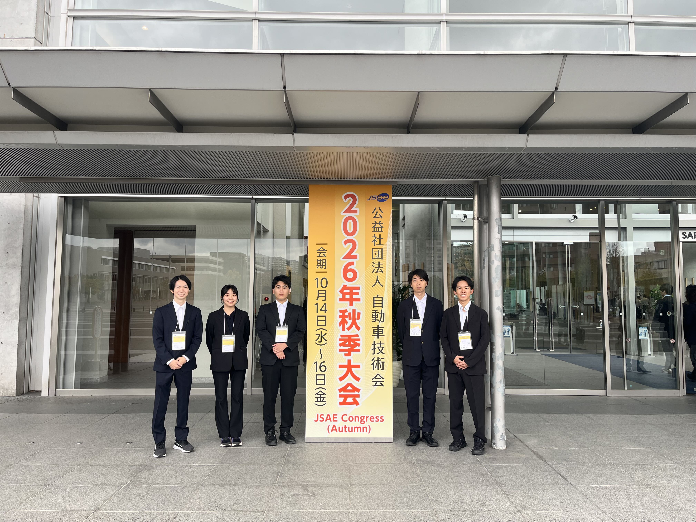
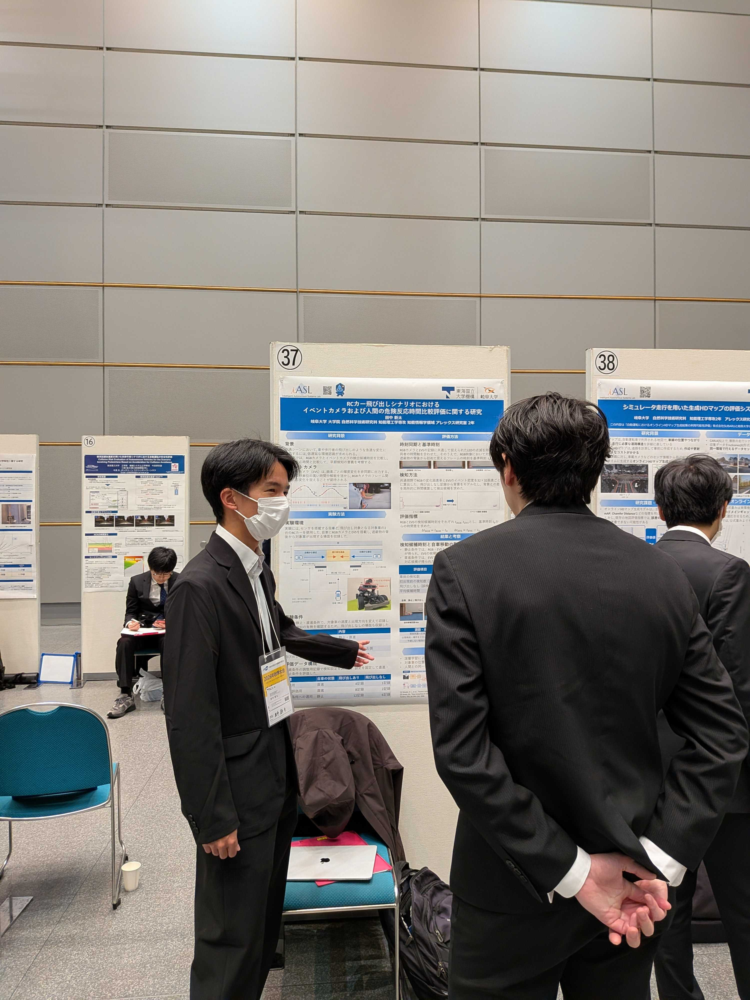
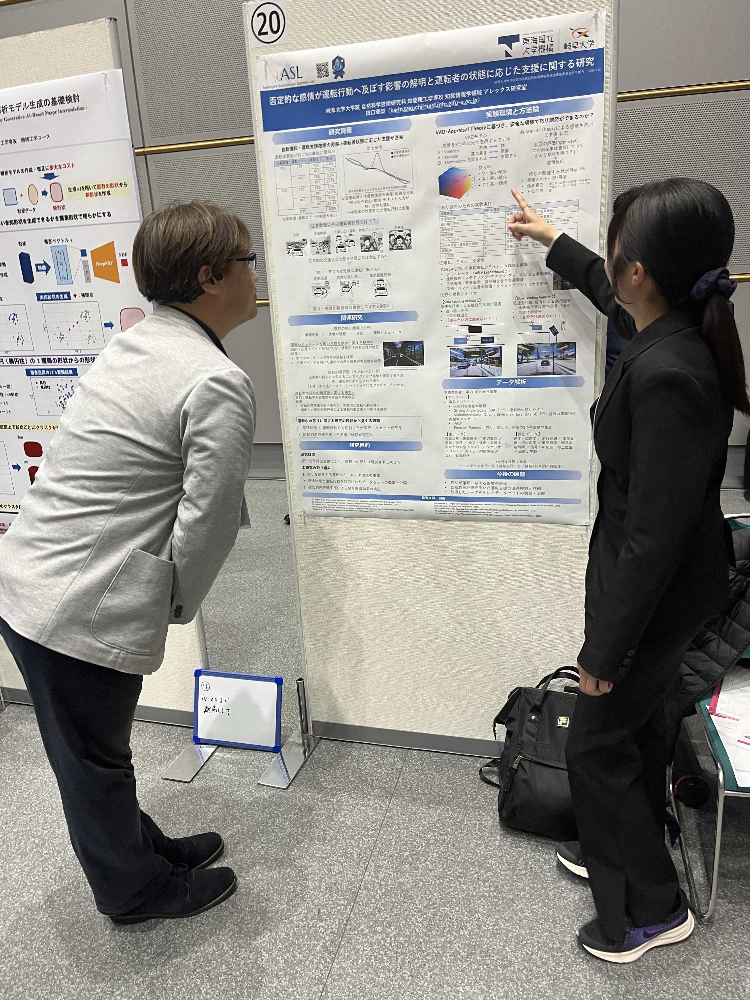
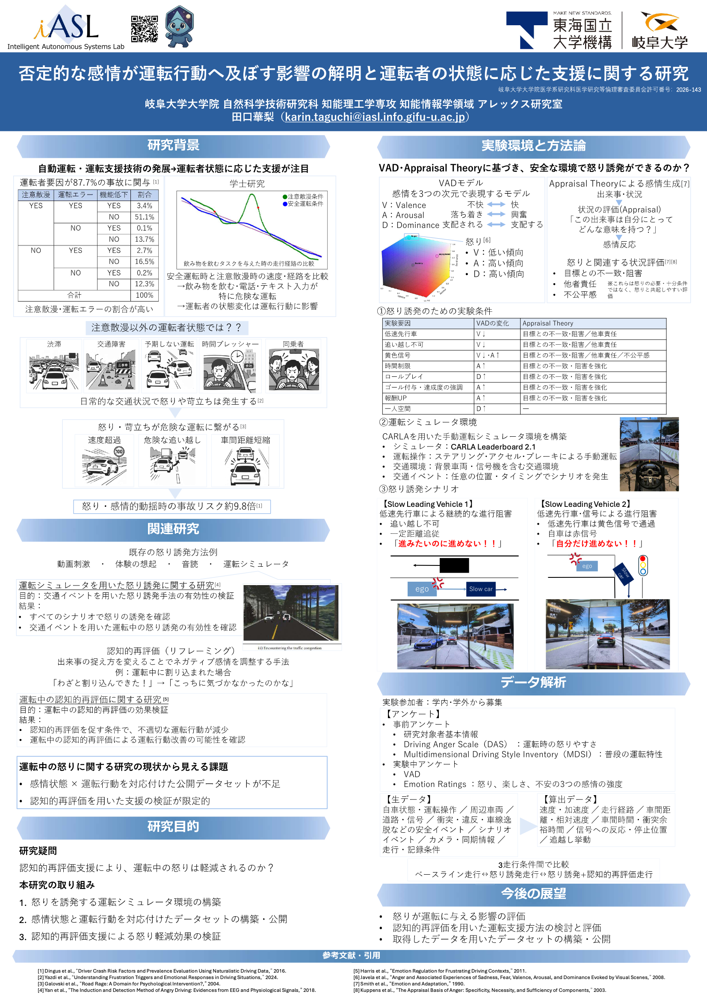

# 自動車技術会2026年秋季大会に参加しました

2026年10月14~16日に北海道で開催された自動車技術会2026年秋季大会に参加し、ポスターセッションにて研究発表を行いました。

### 参加者コメント

iASLとして初めて、自動車技術会の学術講演会に参加しました。

会場には自動車関連企業の方々が多数参加されていました。学術講演会では企業の技術発表も多く行われ、普段は触れる機会の少ない最新技術について知ることができました。

ポスターセッションには、さまざまな分野の研究者が参加していました。自分たちとは異なるテーマに取り組む他大学の方と交流することで、新たな視点を得ることができました。

私たちの発表では、企業の開発現場で研究に携わっている方から、研究内容について具体的なアドバイスをいただくことができました。

いただいた意見を今後の研究に活かしていきたいと思います。

### 発表内容

M2

`田口華梨` 
否定的な感情が運転行動へ及ぼす影響の解明と運転者の状態に応じた支援に関する研究

`田中新太` 
RCカー飛び出しシナリオにおけるイベントカメラおよび人間の危険反応時間比較評価に関する研究

`浜田義正` 
シミュレータを用いたVLA向け運転判断理由データ生成パイプラインの構築

`林隼人` 
シミュレータ走行を用いた生成HDマップの評価システムの構築

M1

`高倉圭太朗`
自動運転におけるワールドモデルの予測品質がVLAの軌道生成に与える影響の評価
