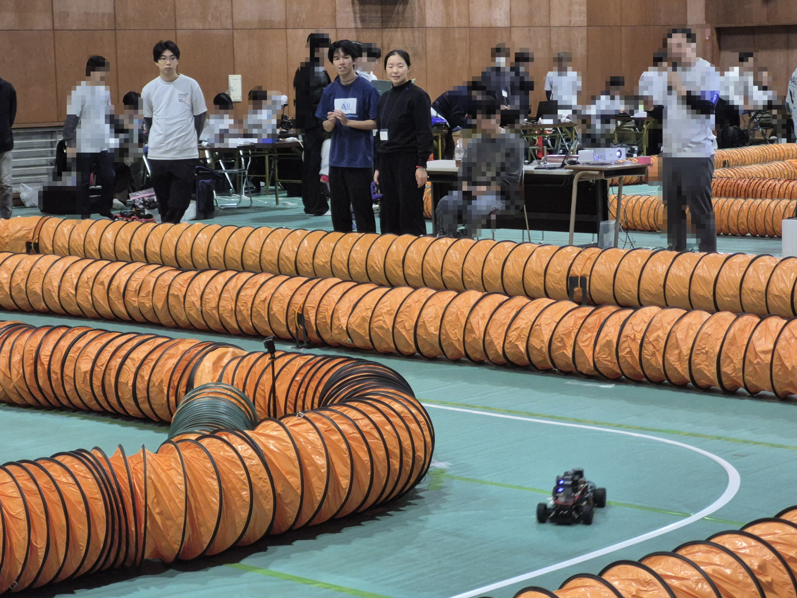
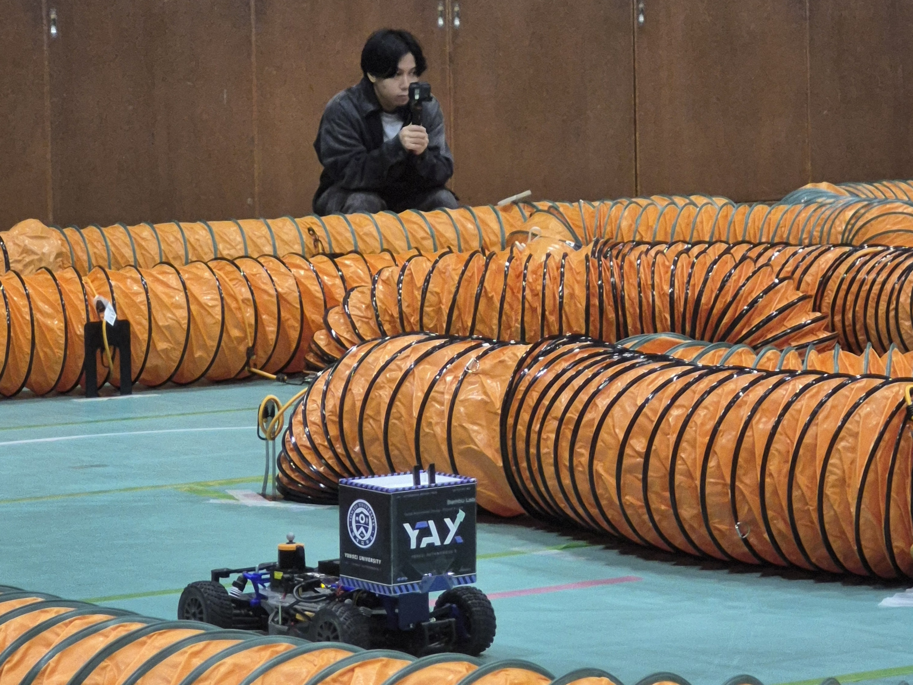
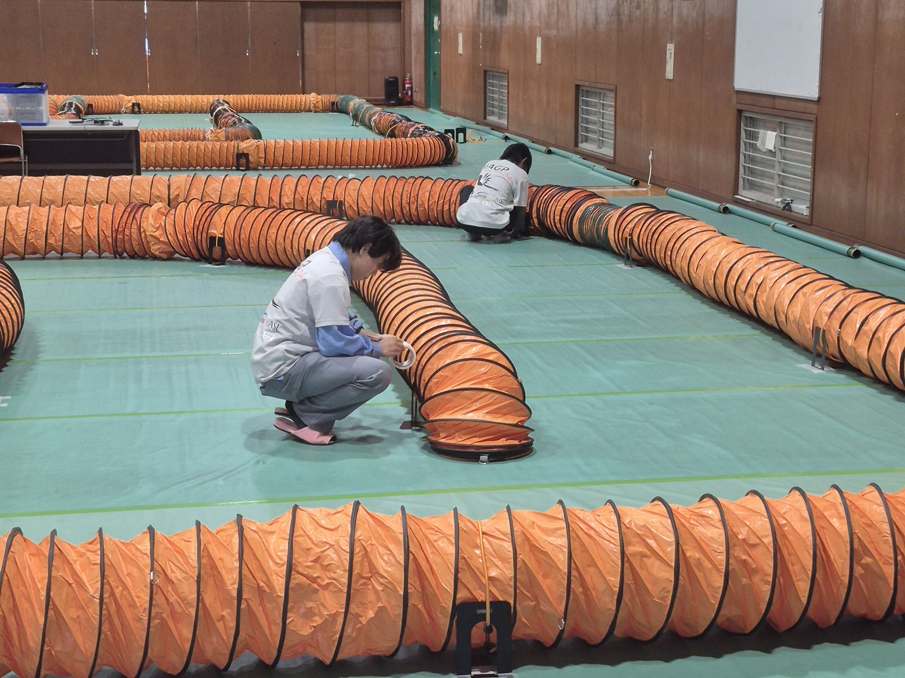
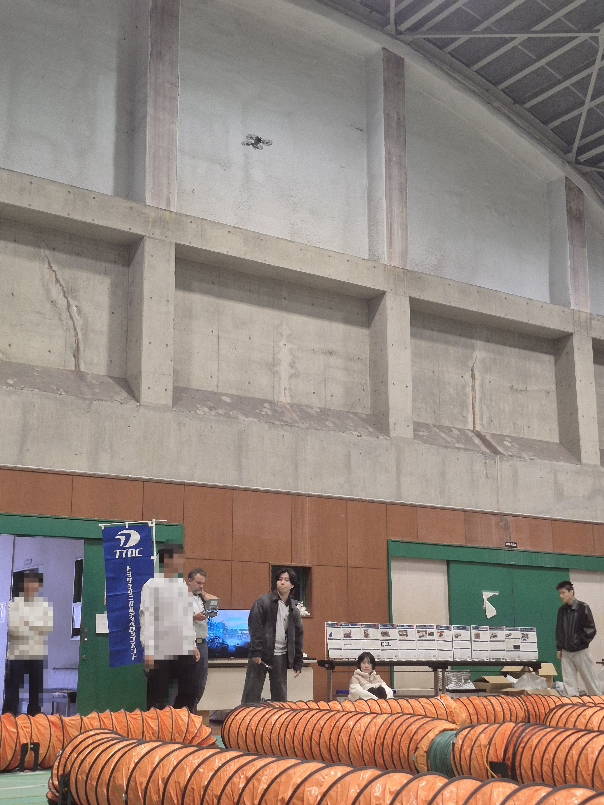
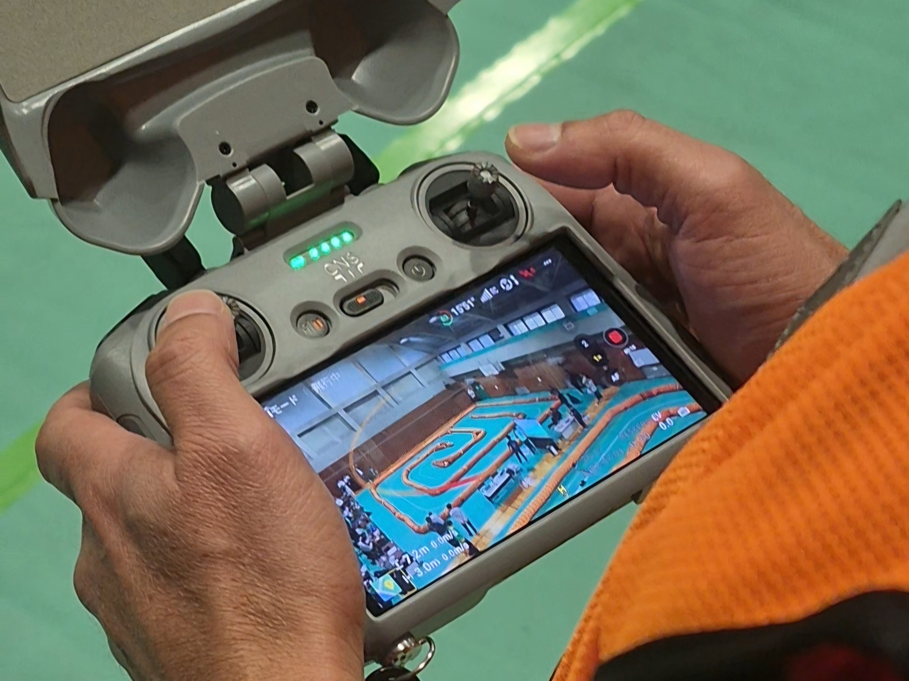
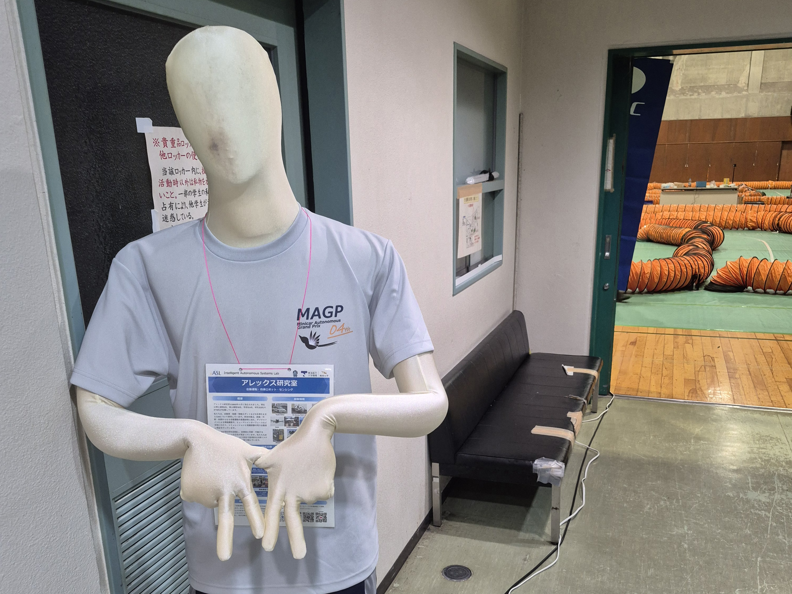

## 第四回 MAGP in 岐阜大学 が開催されました

2026年11月14-15日にラジコンカーのレース大会 MAGPが開催されました。4回目となる本大会では初めて岐阜大学にて開催されました。iASLからは3チームの競技参加に加え、大会運営にも協力しました！

---

### 出場メンバーからのコメント

「iASL-A」チームとして参加した修士2年の田中です。今回の大会はホーム岐阜大学開催ということで優勝を目指してがんばってきましたが、予選で敗退という悔しい結果となりました。学生としての参加は今回で最後となりますが、ぜひ社会人になっても参加し、リベンジしようと思います！

---

### 大会運営メンバーからのコメント

大会運営スタッフとして参加した修士1年の山内と学部4年の大野です。初の岐阜大学での大会開催でしたが、過去最多のチームが参加し、2つの異なるコースで競技を進行するなど、これまで以上に盛り上がる大会となりました。また、海外からの参加もあり、チームの垣根を越えて参加者同士が交流する姿が印象的でした。運営として大会を支えることができ、大変貴重な経験となりました。参加者の皆様、運営にご協力いただいた皆様、ありがとうございました！

---

### iASLの運営協力

iASLの技術協力により、競技中の模様を固定カメラやドローンで撮影し、会場内で配信を行いました。

さらに、大会公式Tシャツを作成し出場者・来場者へ配布しました。

次回大会に向けて、また新たに準備を進めていきます！