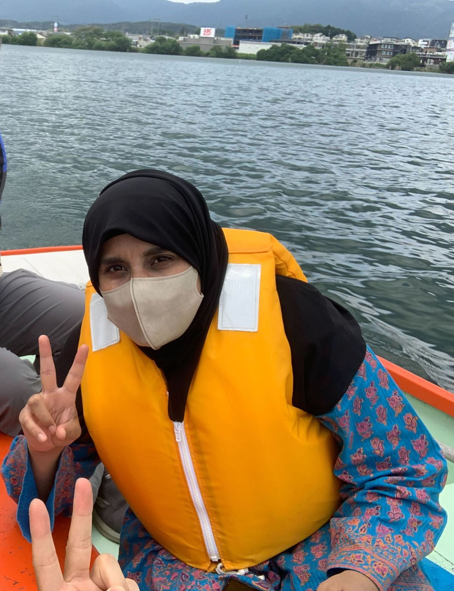

# Hira Akash

## 自己紹介
I am a Ph.D. student from Pakistan at Gifu University, Japan, and a recipient of the Make New Standards (MNS) Scholarship for Next Generation Researchers and the Advanced Global Program (AGP), 2024–2027.

My research focuses on artificial intelligence and multimodal sensor fusion for maritime search and rescue. I am developing methods to detect and localize people in distress at sea by combining microphone arrays and acoustic signal processing with camera-based computer vision.

More broadly, I am interested in deep learning, multimodal perception, acoustic sensing and autonomous systems with the goal of building reliable AI technologies that make maritime rescue faster and safer.

## 出身地
- Kallurkot, Bhakkar-Pakistan

## 趣味・特技
- Traveling and exploring new cultures
- Cooking
- Community volunteering and cultural exchange activities
- Exploring emerging technologies and innovations

## 活動紹介
- **Research:** Developing AI-based methods to detect and localize human distress signals at sea using microphone arrays and camera data
- **Academic Publications:** Engaged in research writing and publications in peer-reviewed journals and international conferences
- **Programs:** MNS Scholarship recipient and member of the Advanced Global Program (AGP), 2024–2027

## リンク
- [Webサイト](https://example.com)
- [GitHub](https://github.com/your_username)
- [X](https://twitter.com/your_username)